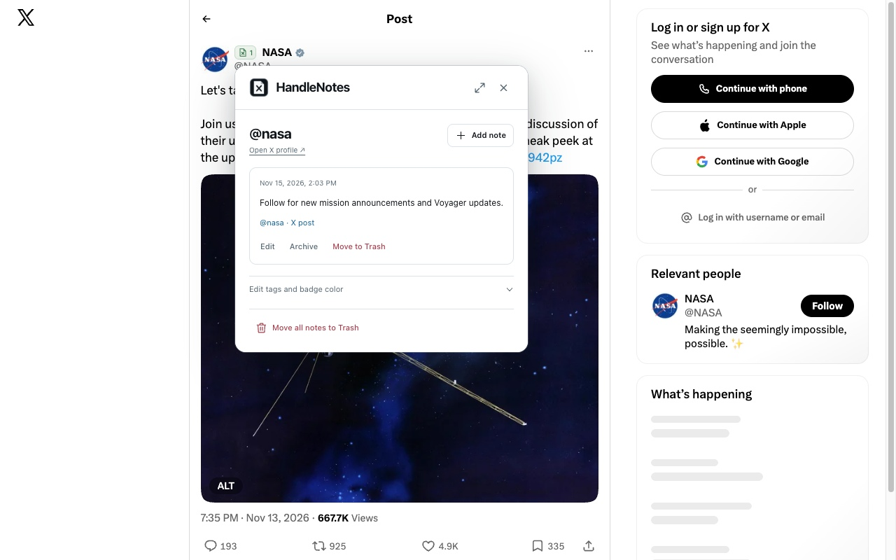

# HandleNotes — Private Notes for X

HandleNotes is a Chrome extension for leaving private notes on accounts you see on X. The note button sits beside the account name and shows how many active notes you’ve saved. Keep multiple notes per account, link back to posts, add tags, and organize notes in the archive or Trash.

The screenshot shows HandleNotes on a public NASA post with a sample note. [View the original post](https://x.com/NASA/status/2121280846183137564)

## Install locally

1. Download and extract the ZIP from the [latest GitHub release](https://github.com/togiwan/handlenotes/releases/latest).
2. Open `chrome://extensions` in Chrome. Turn on **Developer mode** and select **Load unpacked**.
3. Select the extracted folder containing `manifest.json`. If you are working from a Git checkout, select the `extension` folder.
4. Refresh open X tabs. Use the note button beside an account or open HandleNotes from the Chrome toolbar.

## Use HandleNotes

- Open the note button on a supported post or profile. HandleNotes fills in the post URL when it can identify the source.
- To add a note manually, open **Add note** and enter the account’s `@username`.
- Open **Accounts** to search notes, view edit history, or manage archived and deleted notes.
- Use **Backup** to download a JSON copy of your notes, including edit history, the archive, and Trash. You can preview a backup before importing it.

HandleNotes matches accounts by their X username. If someone changes their username, find your notes under their previous handle in **Accounts**. If X reassigns an old handle, its button can still show notes associated with that handle.

Your notes stay in your Chrome profile. HandleNotes needs no extension account, server, or X API access. Export a backup before removing the extension or deleting your Chrome profile. [How HandleNotes handles your data](PRIVACY.md)

## Support

HandleNotes is free. If you’d like to support its development, open **Settings → Donation options** for the TRX and USDT addresses on TRON.

## Development

Use Node.js and Python 3 to run `npm test`, `npm run check`, and `npm run package`. The ZIP is created in `dist/`. To regenerate the icons, run `python3 scripts/generate-icons.py`.

HandleNotes was adapted from EkşiBellek. It is an independent project and is not affiliated with X. [MIT license](LICENSE)
